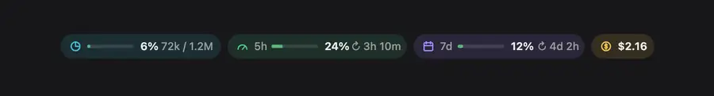

# Context Tracker

A band above the Claude Code prompt showing how much room is left in the conversation, how close the usage limits are, what the session has cost, and a slider to change reasoning effort without leaving the prompt.



Claude Code tells you none of this until it quietly compacts and you lose the thread.

## What the pills mean

| Pill | Shows |
|---|---|
| **ctx** | How much of the usable context window is gone, as a percentage and as `used / window` |
| **5h** | How close the rolling five-hour limit is, and when it resets |
| **7d** | How close the weekly limit is, and when it resets |
| **$** | What this session has cost so far |
| **effort** | The current reasoning effort — click to move between `low · med · high · xhigh · max` |

Each bar turns amber past 60% and red past 85%.

## The window figure is the awkward one

It isn't the model's advertised size. It's the **auto-compact threshold** — the point where Claude Code starts summarising — and that moves with the model and with your settings. A band that showed the advertised size would tell you that you had room right up until the moment you didn't.

So the plugin reads both: `rawMaxTokens` and `autoCompactThreshold`, fingerprints them every thirty seconds, and only recomputes when something has actually changed. When auto-compact is off it falls back to the raw window.

## Install

Requires Claude Code with plugin support.

```bash
git clone https://github.com/Biilow/context-tracker.git ~/.claude/plugins/context-tracker
```

Then enable it in `~/.claude/settings.json`:

```json
{ "plugins": ["context-tracker"] }
```

Restart Claude Code. The band appears above the prompt on the first reply — token counts are absent until then, so it shows `0%` briefly.

## Layout

```
hooks/register.tsx   the whole plugin: atoms, the tray renderer, the effort control
hooks/hooks.json     module manifest
types/index.d.ts     Snap, Compact, Effort, Level
tests/usage.test.tsx the window/threshold maths and the effort round-trip
```

`register.tsx` is TypeScript that Claude Code loads directly — there is no build step.

## Tests

```bash
npx tsx tests/usage.test.tsx
```

## Licence

MIT. See [LICENSE](LICENSE).
